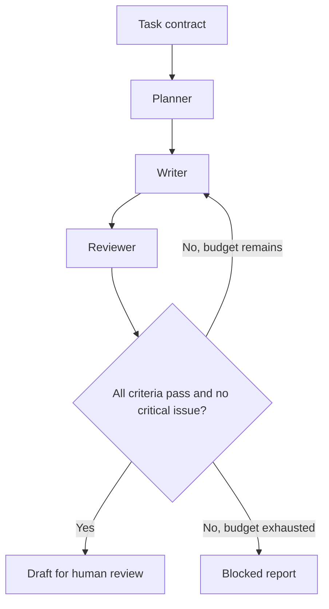

# AI Agent Factory

**Build smaller, safer and measurable AI agent teams.**

[العربية](README.ar.md) · [Security](SECURITY.md) · [Roadmap](ROADMAP.md) · [Contributing](CONTRIBUTING.md)

**v0.1.0 — starter implementation of the V3 design.** Not a production autonomous agent platform.

This project has two independent parts: a portable [Agent Skill](skills/ai-agent-factory/SKILL.md) for coding assistants, and a Python reference runtime that actually runs a bounded planner → writer → reviewer workflow. The skill describes the broader architecture; the runtime implements a deliberately small subset.



## 1. Install the skill in your coding assistant

Download or clone this repository from its actual public URL once published, or extract the release archive. Copy the **entire** `skills/ai-agent-factory/` directory into the destination below inside your own project. Do not overwrite an existing skill without reviewing it first.

| Host | Project-local destination |
|---|---|
| Google Antigravity | `.agents/skills/ai-agent-factory/` |
| Codex | `.agents/skills/ai-agent-factory/` (verify in your version) |
| Claude Code | `.claude/skills/ai-agent-factory/` |

Open your project, refresh/restart the assistant if necessary, and ask:

> Use the ai-agent-factory skill to design and test a team for my Laravel release process. Start read-only, compare a single-agent baseline, and ask before making changes.

Antigravity and Claude Code also support invoking the skill by `/ai-agent-factory` where available. In Codex ask by name or use the skill picker supported by your client. No additional framework or API key is required to load the skill; the host's own model usage and permissions still apply. Paths and discovery mechanisms can change; see official docs below. Native host execution has not been tested in this release.

## 2. Run the companion runtime (no dependencies)

Requirements: Python 3.10+; Windows, macOS or Linux. No pip install, credentials, or network calls in demo mode. Open a terminal **in the extracted repository root**.

```bash
python -m unittest discover -s tests -v
python -m factory run examples/task.en.json
python -m factory run examples/task.ar.json
```

On Windows use `py -3` instead of `python` if necessary; on Linux/macOS use `python3` if necessary. A run ID is printed to stderr, and a JSON report to stdout. Files are created under `.factory-runs/<run-id>/`:

- `state.json`: task, checkpoint, outputs, and role history.
- `report.json`: status, review score, calls and limitations.
- `draft.json`: produced only when all criteria pass and no critical issue is reported; still an unapproved draft.

The demo is **deterministic**, not an AI benchmark. It turns criteria into a checklist and verifies literal checklist presence. It never claims those checks actually ran.

## 3. Use an actual local model (optional)

Install Ollama separately from its official website if you choose. Start the local service and install a model you have reviewed. This project never installs or downloads models for you. Run `ollama list` to find the exact installed model name. Replace `YOUR_INSTALLED_MODEL` below (do not type it literally).

```bash
python -m factory --backend ollama --model YOUR_INSTALLED_MODEL run examples/task.en.json
```

The runtime calls `http://127.0.0.1:11434/api/chat` only. It does not provide tools or execute model output. Planner, writer and reviewer are separate calls with distinct instructions, not independent processes or guaranteed independent models. Use a genuinely local model, not a cloud-backed model or forwarding service, if privacy matters. This adapter has been tested with mocked API responses only; live inference and output quality depend on your installation. Local models still consume hardware and electricity.

## 4. Define your own task

Copy an example JSON file to a private location. Set `goal`, `context`, `language` (`en` or `ar`) and 1–8 unique, verifiable `criteria`. No secrets or private customer data. Example:

```json
{
  "goal": "Draft a weekly SEO report template",
  "context": "No live analytics supplied. Do not invent metrics.",
  "criteria": ["Include organic traffic fields", "Distinguish missing data from measured data"],
  "language": "en"
}
```

```bash
python -m factory run path/to/task.json
python -m factory show RUN_ID
python -m factory resume RUN_ID
```

Replace `RUN_ID` with the real 32-character run ID. For Ollama resume, repeat the same backend and model flags before `resume`. `--revisions 0` through `2` controls revision rounds (default two). At most 3–7 role calls depending on revision budget; failures also consume calls. `--timeout` is a socket timeout, not a hard wall-clock deadline. Resume does not rerun completed steps; an interrupted in-flight call may be retried if budget remains. A blocked run is terminal; create a new task after addressing issues. A stale `.lock` may be removed manually only when no process is active.

## 5. Verification and limits

| Feature | Status |
|---|---|
| Portable skill and bilingual documentation | Included; host discovery not integration-tested |
| Sequential planner/writer/reviewer and bounded revisions | Implemented and unit-tested |
| Checkpoint, resume, run reports, call limits | Implemented and unit-tested |
| Offline checklist demo | Executed locally |
| Ollama integration | Mock-tested; live model not tested |
| Quality | All mandatory checks must pass; model review is advisory, not factual proof |
| External actions / automatic deployment | Not implemented; model has no execution tools |
| Dynamic team creation, parallelism, multi-provider routing, persistent organizational learning, scheduling | Skill guidance / future roadmap only |

The runtime is **draft-only** and has no publish, payment, shell execution, or third-party connectors. The host skill is textual guidance, not a security boundary. Treat every model output as untrusted, and validate manually before use. See [SECURITY.md](SECURITY.md).

## 6. Publish and contribute

See [PUBLISHING.md](PUBLISHING.md) for GitHub publication in both languages. The suggested repository name is `ai-agent-factory`; the owner selects the actual GitHub account. Review the MIT license and copyright attribution before publishing. Contributions are welcome; see [CONTRIBUTING.md](CONTRIBUTING.md).

## Official references

- Agent Skills specification: https://agentskills.io/specification
- Google Antigravity skills: https://antigravity.google/docs/skills
- Claude Code skills: https://code.claude.com/docs/en/skills
- Codex skills: https://developers.openai.com/codex/skills
- Ollama chat API: https://docs.ollama.com/api/chat

[MIT License](LICENSE)
