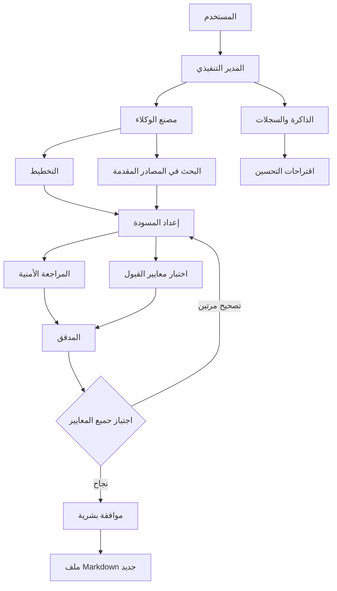

# الهيكل المعماري — معاينة v0.2

[English](ARCHITECTURE.md)

هذه إضافة إلى الإصدار السابق دون تغيير أمر تشغيله. تدعم منظومة متعددة الأدوار ضمن حدود إعداد المسودات محليًا. لا تنفذ أوامر النظام العشوائية أو النشر أو تصفح الإنترنت.



## التشغيل

يتطلب Python 3.10 أو أحدث دون مكتبات خارجية.

```bash
python -m factory.architecture --project example run examples/architecture.ar.json
python -m factory.architecture --project example show RUN_ID
python -m factory.architecture --project example optimize
python -m factory.architecture skill security
python -m unittest discover -s tests -v
```

الوضع الافتراضي محاكاة حتمية لا تستخدم نموذجًا حقيقيًا ولا تسمح باعتماد المسودة للتصدير. لتشغيل نموذج Ollama محلي مثبت مسبقًا:

```bash
python -m factory.architecture --project example --model YOUR_LOCAL_MODEL run examples/architecture.ar.json
python -m factory.architecture --project example --model YOUR_LOCAL_MODEL resume RUN_ID
python -m factory.architecture --project example show RUN_ID
python -m factory.architecture --project example approve RUN_ID --digest EXACT_DRAFT_DIGEST --output reviewed.md
```

راجع المسودة قبل أمر الاعتماد، فهو موافقة صريحة على محتوى محدد ببصمته الرقمية. لا يستبدل النظام أي ملف موجود. يمكن اختيار نموذج لكل دور باستخدام --role-model ROLE=MODEL.

## ما يعمل وما لا يعمل

- مدير تنسيق ومخطط اعتماديات فعلي، وتوازٍ بين الأدوار المستقلة.
- إنشاء فريق وفق وجود مصادر البحث ضمن سجل أدوار محدد، وتوليد تعليمات المهارات.
- البحث مقتصر على النصوص المقدمة مع تحقق من الاقتباسات.
- التنفيذ مقتصر على إعداد مسودة؛ الاختبار والأمن والتقييم أدوار مراجعة وليست تدقيقًا أمنيًا خارجيًا.
- حفظ الحالة واستئنافها وسجل لكل دور ضمن مجلد مستقل للمشروع.
- بوابة قبول إلزامية ومحاولتا تصحيح وسقف 30 طلبًا؛ عند الفشل يتوقف النظام.
- قياسات وقت التنفيذ والتوكنات عند توفرها واقتراحات تطوير دون تعديل ذاتي.
- تصدير مسودة إلى ملف محلي جديد بعد موافقة صريحة بالبصمة.

لم تُضف أدوات التحكم بالخوادم أو قواعد البيانات أو تنفيذ Shell أو البحث الحي أو الجدولة أو التشفير أو ذاكرة دلالية. لا يمثل ذلك نظامًا جاهزًا للإنتاج. لا تستخدم بيانات سرية، وفحص الأنماط ليس حماية كاملة. إذا انقطع البرنامج أثناء التصدير، افحص الملف قبل إعادة المحاولة. لا تستخدم ملفات حالة من مصادر غير موثوقة. اختبارات النموذج الحي لازمة قبل الاعتماد الفعلي.
