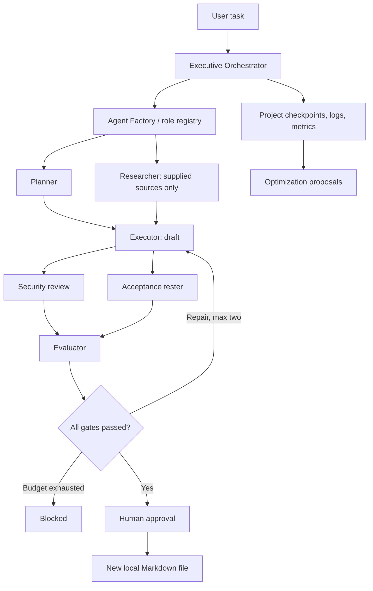

# Architecture preview — v0.2

This implementation is additive: the stable v0.1 CLI is unchanged. The preview implements the proposed architecture for **bounded, local, draft-only workflows**. It does not execute arbitrary code, browse the internet or deploy changes.

[العربية](ARCHITECTURE.ar.md)



## Run

Python 3.10+; no Python dependencies.

```bash
python -m factory.architecture --project example run examples/architecture.en.json
python -m factory.architecture --project example show RUN_ID
python -m factory.architecture --project example optimize
python -m factory.architecture skill security
python -m unittest discover -s tests -v
```

Demo is a deterministic fixture, not AI; it cannot export approved drafts. With an already installed local Ollama model:

```bash
python -m factory.architecture --project example --model YOUR_LOCAL_MODEL run examples/architecture.en.json
python -m factory.architecture --project example --model YOUR_LOCAL_MODEL resume RUN_ID
python -m factory.architecture --project example show RUN_ID
python -m factory.architecture --project example approve RUN_ID --digest EXACT_DRAFT_DIGEST --output reviewed.md
```

The last command is the user's explicit approval of that exact draft, creating a new Markdown file only. Inspect the draft before approving. Use repeatable --role-model ROLE=MODEL to choose separate local models. Resume using the same model configuration.

## Components and actual boundaries

- Orchestrator: validated role contracts, dependency layers, checkpoint/resume, at most two correction rounds and 30 calls.
- Agent factory: dynamically omits research if no sources; fixed vetted role registry. Skill generator exports role-specific instructions to stdout.
- Model router: per-role local Ollama model selection. No cloud fallback or key requests.
- Research: supplied text only; citations are verified as exact source excerpts, not verified facts.
- Executor: draft generation only, never arbitrary system operations.
- Security, tester and evaluator: separate calls, mandatory veto, with deterministic structural checks. Same model may be reused; this is not fully independent security assurance.
- Parallel layers: planning/research and security/tester; tasks with dependencies wait.
- Memory: project-scoped JSON checkpoints, role history and measured timings/token counts when available. Keep data on trusted local storage. No semantic/vector memory, encryption or OS sandbox.
- Improvement: aggregate role failure/latency metrics and propose a controlled experiment; no autonomous prompt or policy changes. Demo runs excluded.
- Budget: hard count of model calls and bounded request size/timeout; no financial pricing, global wall clock or scheduler.
- Approval: exact draft digest, explicit CLI invocation and exclusive file creation. A filesystem crash after export and before checkpoint can leave an exported file; inspect before retrying. Never use an untrusted checkpoint.
- Secret patterns are heuristic, not comprehensive. Do not include secrets. Do not expose Ollama or local run data to the network.

Live model quality, OS isolation, broad tool adapters, verified external research and real production actions require further development and testing. No production readiness claim.
